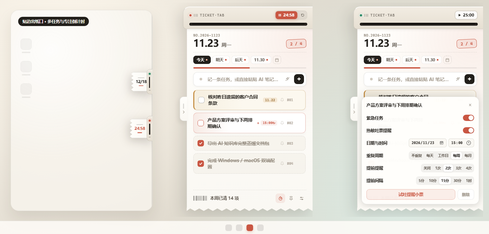
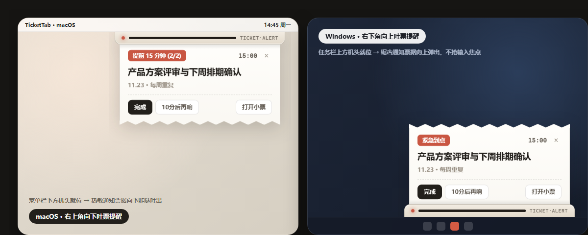
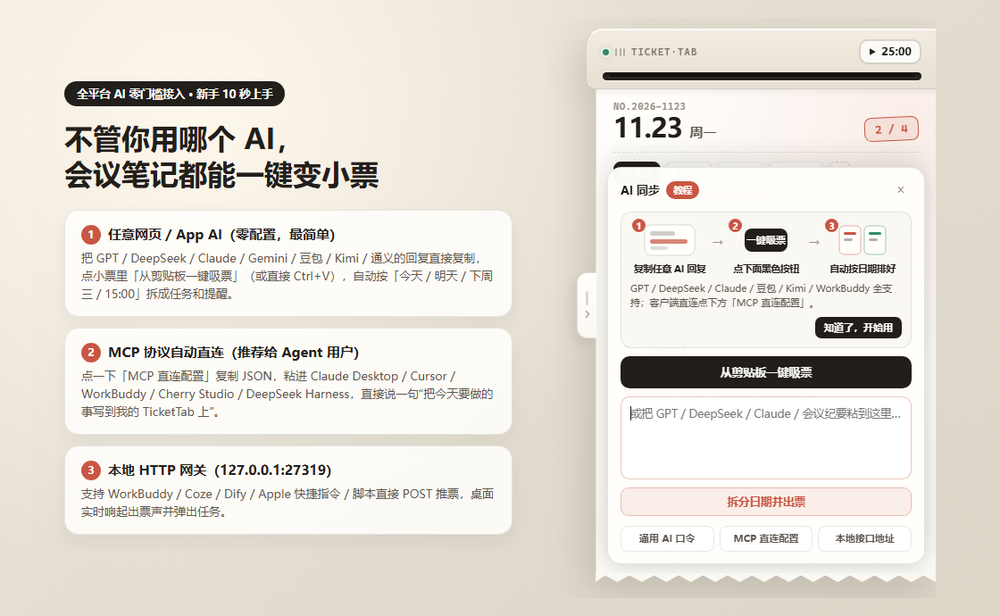

<div align="center">
  
  <h1>TicketTab v1.0.0</h1>
  <p><strong>贴在屏幕边缘的迷你热敏小票机桌面任务板 · 支持 Windows &amp; macOS · 全平台 AI 接入</strong></p>

  <p>
    
    
    
    
    
  </p>
</div>

<p align="center">
  
</p>

---

## 为什么做 TicketTab？

大多数待办软件要么太重（打开要等半天、功能堆满屏幕），要么藏在浏览器标签页里根本想不起来看。  
**TicketTab** 是一台**悄悄贴在屏幕边缘的迷你热敏小票机**：

- **平时零打扰**：只在屏幕左/右边缘露出一截陶瓷出纸口与带锯齿的小票纸舌，一眼看清进度（如 `12/18`）或专注倒计时（`24:58`）；按住拖过屏幕中线即可换边。
- **一点就丝滑滑出**：采用固定透明画布 + 鼠标穿透 + 纯 GPU 滑轨，60/120fps 顺滑收放、绝不闪跳。
- **用完超解压**：当天任务全部勾选完成变成 `ALL DONE` 后，会触发真实感十足的**热敏受热烘烤消字动画**，字迹泛黄消散归档；没做完的第二天自动顺延置顶，并换上泛黄旧票纸色 + 原日期角标（如 `11.22`）清晰区分。

---

## 核心功能一览

### 1. 热敏吐票式桌面提醒弹窗（macOS 右上角向下吐票 / Windows 右下角向上吐票）

每条任务右侧点一下小铃铛即可打开配置卡片，自由设置：
- **是否紧急**（红框高亮置顶）
- **具体日期与时间点**（也支持直接打字 `每周一 15:00 产品评审` 自动识别）
- **重复周期**：`不重复 / 每天 / 工作日 / 每周 / 每月`（勾选完成后自动在下一个周期生成新任务）
- **提前多轮提醒**：支持 **提前 1 次 / 2 次 / 3 次 / 4 次** 提醒，间隔可选 `5分 / 10分 / 15分 / 30分 / 1小时`，到点还会再吐一次正式提醒
- **一键试吐提醒小票**：点一下就能立刻看实机吐票动画！弹窗支持直接点 **「完成」 / 「10分后再响」 / 「打开小票」**，且绝不抢走你当前打字的焦点。

<p align="center">
  
</p>

---

### 2. 全平台 AI 零门槛接入（新手 10 秒上手）

不管你用的是 **ChatGPT、DeepSeek、Claude、Gemini、豆包、Kimi、通义千问，还是 WorkBuddy / Cursor / Cherry Studio**，会议笔记和聊天总结都能直接变成桌面的多日任务小票！  
首次点击输入框里的 **`✦`** 时，软件内部会自动弹出 **3 步图解新手教程**，随时也可点「教程」重看：

<p align="center">
  
</p>

| 接入方式 | 适用对象 | 怎么用（极简） |
|---|---|---|
| **方式 1 · 剪贴板一键吸票（最推荐新手）** | 所有网页 / App AI（GPT / DeepSeek / 豆包 / Kimi / Gemini 等） | 复制 AI 回复 → 点 **`✦`** → 点 **「从剪贴板一键吸票」**（甚至直接 `Ctrl+V` 贴进输入框），自动按「今天 / 明天 / 后天 / 下周三 / 15:00」拆条排期 |
| **方式 2 · 标准 MCP 协议直连** | Claude Desktop / Cursor / WorkBuddy / Cherry Studio / DeepSeek Harness | 点 **`✦`** → 点 **「MCP 直连配置」** 复制 JSON 粘贴进客户端设置，直接对话让 AI 读写桌面任务板 |
| **方式 3 · 本地 HTTP 网关** | WorkBuddy / Coze / Dify / 快捷指令 / Python & Shell 脚本 | `POST http://127.0.0.1:27319/import`，实时响起出票声并在桌面弹出新票据 |

---

### 3. 25 分钟专注倒计时 × 4 种悬浮样式 × 4 套明亮纸感配色

- **内置专注倒计时**：嵌入热敏机头右上角，点击开始/暂停（右键循环切换 `25 / 15 / 45` 分钟）。收起面板后，贴边悬浮窗自动联动显示实时跳动的 `24:58` 倒计时与呼吸灯。
- **4 种悬浮窗一键切换**：`真实出纸口（默认）` / `探头动漫小票机` / `苹果灵动胶囊` / `复古小硬件计数器`，完美自适应 10+ 多任务数字（绝不溢出或乱码）。
- **4 套护眼纸张配色**：`暖象牙` / `樱桃粉` / `抹茶绿` / `晴空蓝`，以及悬停自动滑出、热敏自动消字、未完成自动顺延、失焦固定、纸张音效与开机自动启动开关。

---

## 下载与安装（Release v1.0.0）

### 方式一：直接下载安装包（GitHub Releases）
前往本仓库右侧 **Releases → v1.0.0** 下载对应系统版本：
- **Windows**：`TicketTab 1.0.0.exe`（免安装绿色单文件，双击即用）
- **macOS**：`TicketTab-1.0.0-arm64.dmg`（M1/M2/M3/M4 芯片）或 `TicketTab-1.0.0.dmg`（Intel 芯片）

### 方式二：本地从源码运行 / 自行打包
> 需要 Node.js 20+ 与 pnpm

```bash
pnpm install
pnpm start
```

打包命令：
```bash
pnpm run build:win   # 打包 Windows 便携版 .exe
pnpm run build:mac   # 在 MacBook 上打包 arm64 + x64 双架构 .dmg
pnpm test            # 运行全部自动化单元测试
```

> **云端自动打包**：仓库已内置 [`.github/workflows/release.yml`](./.github/workflows/release.yml)。推送 `v1.0.0` 标签或在 GitHub **Actions** 点击 `Run workflow`，即可自动构建 Windows `.exe` 与 macOS `.dmg` 并自动创建 GitHub Release！

---

## 本地 AI HTTP API 速查（`http://127.0.0.1:27319`）

```bash
curl -X POST http://127.0.0.1:27319/import \
  -H "Content-Type: application/json" \
  -d '{"text":"今天 15:00 完成产品评审 !\n每周五 17:00 提交周报\n下周三 客户演示"}'
```

| 接口 | 方法 | 说明 |
|---|---|---|
| `/health` | `GET` | 检查在线状态与端口 |
| `/tasks?date=YYYY-MM-DD` | `GET` | 读取指定日期任务与未来排期 |
| `/import` | `POST` | 批量解析自然语言 / 会议纪要 / JSON（支持时间与重复） |
| `/tasks` | `POST` | 新增单条或多条结构化任务 |
| `/tasks/:id/toggle` | `POST` | 勾选 / 取消勾选任务 |
| `/tasks/:id` | `DELETE` | 删除指定任务 |

## License

[MIT](./LICENSE)
